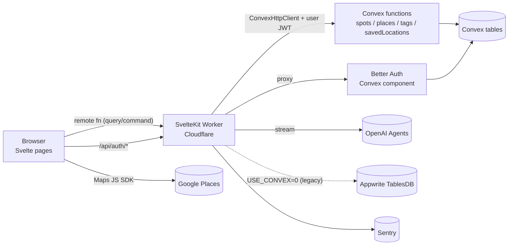
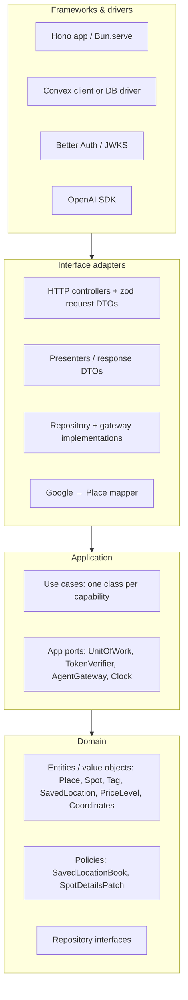

# Bite Marks: server layer spec

This document lists everything the bite-marks-2 server layer does today, so that it can be rebuilt in `bm-backend` as a standalone service using Clean Architecture rather than the ports-and-adapters layout bite-marks-2 uses now.

- **Source of truth:** `bite-marks-2` at `86a71a9` (Oct 2026), with `USE_CONVEX=1` (the production path).
- **Target:** `bm-backend` (Hono on Bun; the `domain / application / interface-adapters / infrastructure` layout already exists there).
- **Scope:** anything that runs on the server: SvelteKit hooks, remote functions, `+server.ts` / `+page.server.ts`, the `src/lib` core, and the Convex functions in `src/convex`. Logic that runs only in the browser is listed in §9 so that nothing is forgotten, but it is out of scope.

---

## 1. Current runtime topology



Request lifecycle (`src/hooks.server.ts`):

1. Sentry is initialised (`initCloudflareSentryHandle`, `sentryHandle`). It is disabled in dev, and any event whose request URL is a local hostname is dropped (`sentry/event-filter.ts`).
2. The Better Auth JWT is read from cookies (`getToken(event.cookies)`) and stored in `locals.token`.
3. The request is wrapped in `withServerConvexToken(token)`, so every `createConvexHttpClient()` made during the request is authenticated as the user.
4. If a token is present, `api.auth.getCurrentUser` is called. The result is mapped to `locals.user = { id, email, name }`. On any error, `locals.user` is `null` and the error is logged.
5. Page route guard (`+layout.server.ts`): an unauthenticated user is sent with a 303 to `/login`, except on `/login`, `/all-spots` and `/api/auth/*`. An authenticated user who visits `/login` is sent with a 303 to `/`.

Where the layers live today (ports and adapters):

| Concern | bite-marks-2 location |
|---|---|
| Domain schemas (zod) | `src/lib/core/domain/{Place,Spot,Tag,Location}` |
| Use case | `src/lib/use_cases/placeAndSpot.ts` (one class, thin pass-through) |
| Ports | `src/lib/ports/*.repository.ts` |
| Inbound adapters | `src/lib/adapters/primary/remote-handlers/*.remote.ts`, `routes/**/+page.server.ts`, `routes/**/+server.ts` |
| Outbound adapters | `src/lib/adapters/secondary/{convex,appwrite,google,sentry}` |
| Composition root | `src/lib/glue/di-container.ts` |
| **Business rules (actually)** | **Inside the Convex mutations** in `src/convex/*.ts` |

The last row is the main finding. Most real behaviour (dedupe, the location cap, choosing the default location, ownership) is in Convex function bodies, not in `use_cases`. The rebuild must lift those rules into the domain and application layers.

---

## 2. Domain model

### 2.1 Place (shared catalog)

One row per Google place. It is shared by every user and keyed by the Google Place id.

| Field | Type | Notes |
|---|---|---|
| `placeId` / `place_id` | string | Google Places id. Unique (index `by_place_id`). |
| `name` | string | |
| `address` | string | Google `formattedAddress` |
| `rating` | number? | Google rating |
| `websiteURI` | string \| null? | |
| `priceLevel` / `price_level` | string | One of `free \| inexpensive \| moderate \| expensive \| very_expensive` (see §6) |
| `lat`, `lng` | number | |
| `photos` | any[] | **Always `[]` today.** Photos are fetched client-side from Google. |
| `neighborhood` | string | From `sublocality` / `neighborhood` address component |
| `areas` | string[] | From `sublocality_level_1`, `administrative_area_1`, `postal_code` |
| `placeTypes` / `place_types` | string[] | Google types with the last 2 dropped and `_` replaced by a space |
| `primaryType` | string? | Raw Google `primaryType` (keeps underscores) |

### 2.2 Spot (user-owned bookmark)

A user's saved reference to a Place, plus their personal notes.

| Field | Type | Default on create | Notes |
|---|---|---|---|
| `id` (`_id`) | id | | |
| `userId` | string | | Better Auth user id (JWT `sub`) |
| `place` | ref → Place | | |
| `placeId` | string | | Denormalised Google id, used for dedupe |
| `name` | string \| null | place name | Denormalised |
| `personalRating` | number \| null | `null` | **No range validation anywhere** |
| `personalNotes` | string \| null | `null` | |
| `isVisited` | boolean | `false` | |
| `socialLinks` | string[] | `[]` | **No URL validation** |
| `legacyUserId` | string? | | Appwrite id. Migration-only; to be dropped |

Invariant: **at most one spot per (userId, placeId)** (index `by_user_place`).

The read model returned to the UI is a **flattened spot plus place** (`UserSpotRecord`): spot fields merged with place fields in snake_case, with `id = rowId = $id = spot._id`. When the place is missing, the defaults are `name ?? place.name ?? ""`, `price_level ?? "free"`, `lat/lng ?? 0`, and `[]` / `""` for collections and strings.

### 2.3 Tag

`{ id, userId, tagName, createdAt, updatedAt }`. `createdAt` and `updatedAt` both come from `_creationTime`, because tags are never updated. **Tags are not linked to spots yet.** They are a flat per-user list.

### 2.4 SavedLocation

| Field | Rule |
|---|---|
| `name` | trimmed, 1–60 chars |
| `lat` | finite, −90…90 |
| `lng` | finite, −180…180 |
| `radiusMiles` | finite, 1…30 (Google `locationBias.circle.radius` caps at 50 km ≈ 31 mi) |
| `isDefault` | at most one `true` per user |

Constants are in `core/domain/Location/limits.ts`: `MAX_SAVED_LOCATIONS = 3`, `MAX_LOCATION_NAME_LENGTH = 60`, `MIN_RADIUS_MILES = 1`, `MAX_RADIUS_MILES = 30`.

`ActiveLocation` (`{ name, center, radiusMiles, savedLocationId }`) and its helpers (`clampRadiusMiles`, `findDefaultLocation`, `activeLocationFromSaved`, `parseActiveLocation`, `findSavedLocationWithChangedRadius`) are pure domain logic, but they are used **client-side only** (see §9).

### 2.5 User (identity)

`{ id, email, name }`, derived from Better Auth. The service never stores user records itself; the Better Auth component owns `user`, `account` and `session`.

---

## 3. Authentication and authorization

### 3.1 Authentication (Better Auth on Convex)

| Capability | How |
|---|---|
| Email + password sign-up | `authClient.signUp.email`. Email verification is **off**. |
| Email + password sign-in | `authClient.signIn.email` |
| Google OAuth | `authClient.signIn.social({ provider: "google" })`. Enabled only when `GOOGLE_CLIENT_ID` and `GOOGLE_CLIENT_SECRET` are both set. Callback is `/api/auth/callback/google`. |
| Sign-out | `authClient.signOut()` |
| Session transport | httpOnly JWT cookie set by Better Auth. The Worker only reads it (`getToken`). It must **not** construct `createAuth()` in workerd (AsyncLocalStorage hang). |
| Auth HTTP surface | `GET/POST /api/auth/*` is proxied by `createSvelteKitHandler()` to the Convex site URL, where `authComponent.registerRoutes(http, createAuth)` serves it. |
| Current user | Convex query `auth.getCurrentUser` → `authComponent.getAuthUser(ctx)` |
| Base URL | `SITE_URL` (Convex env) |

### 3.2 Authorization rules

Every user-scoped operation applies two layers of checks:

1. **Inbound check** (remote handler): `locals.user` must exist, or the response is **401 Unauthorized**. The user id always comes from the session, never from the client. The one exception is `listSavedLocations({ userId })`, which accepts `userId` only to scope the client cache and rejects a mismatch with **403**.
2. **Data check** (Convex function):
   - `requireUserId(ctx)`: throws `"Unauthorized"` if there is no identity, and returns `identity.subject`.
   - `assertUser(argUserId, authUserId)`: throws `"Forbidden"` on a mismatch.
   - Ownership: when a row's `userId` does not match the caller, the operation acts as if the row is **not found** (`null` / `{ success: false }`). It does not throw.

Public (no auth) operations: `places.getAll`, `places.getByPlaceId`, `places.hasByPlaceId`, `health.ping`, the `/all-spots` page load, and the auth routes. **`POST /agent` and `agentRemoteCall` are unauthenticated today, which is a bug** (see §8).

Tested behaviour (`src/convex/spots.test.ts`, `savedLocations.test.ts`) that the rebuild must keep:

- An anonymous `savePlaceAndSpot` or `tags.create` call is rejected with Unauthorized.
- User B calling `spots.getById`, `spots.update` or `tags.listForUser` with user A's id is rejected with Forbidden.
- Saved locations (`savedLocations.test.ts`): anonymous reads and writes are rejected; cross-user access is rejected; the first location saved becomes the default, and only the first; the cap of 3 holds; there is exactly one default after it changes; deleting the default promotes the oldest remaining location; updates trim the name; blank names and out-of-range radii are rejected.

---

## 4. Capability catalog

Each row is one capability the new service must provide. "Entry" is the current inbound path. "Core" is the Convex function that holds the real logic.

### 4.1 Spots

| # | Capability | Entry | Core | Input | Behaviour | Output |
|---|---|---|---|---|---|---|
| S1 | **List my spots** | `spots.remote.getSpots({})` → `PlaceAndSpotUseCase.getSpots` | `spots.listForUser` | session user | Spots `by_user`, newest first, **max 100**. Each spot is joined to its place. | `{ total, rows: UserSpotRecord[] }`. `total` is `rows.length`, not a true count. |
| S2 | **Get one spot** | `spots.remote.getSpotById({ id })` → `getSpotByPlaceId` (misnamed; `id` is the **spot row id**) | `spots.getById` | spot id | Returns `null` if the spot is missing or not owned. Adds `rowId`. | `UserSpotRecord \| null` |
| S3 | **Save a place as a spot** | `spots.remote.saveSpot({ spot: ResultPlaceRecord })` → `upsert` | `spots.savePlaceAndSpot` | Place payload (from Google search) | 1) Normalise the payload (§6). 2) If a spot already exists for (user, placeId), **return it** with `alreadyExisted: true` and leave the catalog alone. 3) Otherwise **upsert the Place** (insert, or patch every catalog field when the `placeId` exists: last writer wins). 4) Insert a spot with defaults (§2.2). All of this runs in one transaction. | `{ success: true, spotResult: FlattenedSpot, alreadyExisted } \| { success: false, error }` |
| S4 | **Update spot details** | `spots.remote.updateSpot({ rowId, data })` → `updateSpot` | `spots.update` | `personal_rating?`, `personal_notes?`, `is_visited?`, `social_links?` | Partial patch. Only provided keys change, and `null` is allowed for rating and notes. Not found or not owned gives `null`, which the handler turns into **404**. | updated `UserSpotRecord` |
| S5 | **Delete a spot** | `spots.remote.deleteUserSpot(rowId)` → `deleteSpot` | `spots.remove` | spot id | Hard delete. The place stays in the catalog. Not found or not owned gives `{ success: false, error }`, still with HTTP 200. | `{ success, error? }` |
| S6 | Check whether I saved a place | *(no UI caller)* adapter `hasUserSpot` | `spots.hasForUserPlace` | placeId | Lookup on `by_user_place` | boolean |

### 4.2 Places catalog

| # | Capability | Entry | Core | Behaviour | Output |
|---|---|---|---|---|---|
| P1 | **List all catalog places** (public) | `/all-spots` `+page.server.ts` → `getAllMasterPlaces` | `places.getAll` | Newest first, **max 200**. No auth. | `MasterPlaceRecord[]` (with `id = placeId`) |
| P2 | Get a place by Google id | adapter `getMasterPlace` (no UI caller) | `places.getByPlaceId` | public | Place \| null |
| P3 | Check whether a place is in the catalog | adapter `hasMasterPlace` (no UI caller) | `places.hasByPlaceId` | public | boolean |

There is no direct place write path. Places are created or updated **only** as a side effect of S3 (or by migration). This rule was set deliberately in BRO-35 and must be kept.

### 4.3 Tags

The tag path bypasses the use case and port layer. `tags.remote.ts` calls Convex directly.

| # | Capability | Entry | Core | Behaviour | Output |
|---|---|---|---|---|---|
| T1 | **List my tags** | `tags.remote.listTags({})` | `tags.listForUser` | Newest first, max 100 | `TagResult[]` |
| T2 | **Create tag** | `tags.remote.createTag({ tagName })` | `tags.create` | `tagName` must be at least 1 char. It is trimmed in the handler, **not** in the core. **No dedupe.** | `TagResult` |

### 4.4 Saved locations

All five operations go through `SavedLocationRepository` and `ConvexSavedLocationRepository`. There is no use case class; the handlers call the repository directly.

| # | Capability | Entry | Core | Rules | Output / errors |
|---|---|---|---|---|---|
| L1 | **List my saved locations** | `listSavedLocations({ userId })` | `savedLocations.listForUser` | `userId` must equal the session user (403 otherwise). Oldest first, max 3. | `SavedLocation[]` |
| L2 | **Create** | `createSavedLocation(input)` | `savedLocations.create` | Validate the name, lat/lng and radius (§2.4). **Cap of 3 reached** gives `{ success: false, error: "You can save up to 3 locations. Delete one to save another." }`. **The new location becomes the default if the user has none.** | `{ success: true, location } \| { success: false, error }` |
| L3 | **Update** | `updateSavedLocation({ id, patch })` | `savedLocations.update` | Partial patch of name, lat, lng and radius, with the same per-field validation. Not found or not owned → 404. | `SavedLocation` |
| L4 | **Set default** | `setDefaultSavedLocation(id)` | `savedLocations.setDefault` | Sets the target to `isDefault = true` and every other location to `false`, patching only the rows that change. Not found → 404. | `SavedLocation` |
| L5 | **Delete** | `deleteSavedLocation(id)` | `savedLocations.remove` | Hard delete. **If the deleted location was the default, the oldest remaining location becomes the default.** Not found → 404. | `{ success: true }` |

Validation runs twice: zod `SavedLocationInputSchema` in the handler, and hand-written asserts in Convex that throw `Error` with user-facing messages. The rebuild should have one domain validator.

### 4.5 Identity, health and the agent

| # | Capability | Entry | Behaviour |
|---|---|---|---|
| A1 | Resolve current user | `hooks.server.ts` → `auth.getCurrentUser` | Token → `{ id, email, name } \| null` |
| A2 | Auth endpoints | `/api/auth/[...all]` | Proxy to Better Auth (sign-up, sign-in, OAuth callback, sign-out, session) |
| H1 | Health check | Convex `health.ping` | Returns `"ok"` |
| X1 | **Agent chat (experimental)** | `POST /agent` `{ prompt }` | OpenAI Agents SDK, model `gpt-5-nano`, low reasoning effort, no tools, joke persona. Streams plain text with an `text/event-stream` content type (it is not actual SSE framing). **No auth.** `routes/agent/tools.ts` is empty. |
| X2 | Agent (non-streaming) | `agent.remote.ts` `agentRemoteCall(prompt)` | Same agent, returns `result.output`. Not used by the UI (it is commented out). |

### 4.6 Admin and migration (internal, CLI only)

These are Convex `internalMutation` / `internalAction` functions, run with `npx convex run` or `scripts/rehearse-migration.ts`. They are never exposed over HTTP.

| Function | Behaviour |
|---|---|
| `migrations.importUsers` | For each Appwrite user: find a Better Auth user by email, or create one. Pre-link a Google `account` when `googleAccountId` is present. Returns a map from `legacyUserId` to the new user id. |
| `migrations.importPlaces` | Upsert each place (`upsertPlaceDoc`). Returns `{ upserted }`. |
| `migrations.importSpots` | Skip a spot when its place is missing (`missingPlace++`) or when (user, placeId) already exists (`skipped++`). Otherwise insert it with `legacyUserId`. Returns `{ inserted, skipped, missingPlace }`. |
| `migrations.importTags` | Plain insert (**not idempotent**). |
| `migrations.verifyMigration` | Counts places, spots and tags, spots whose place is missing, and spots per user. |
| `migrations.dropLegacyUserIds` | Clears `legacyUserId` on every spot. |
| `migrations.applyCredentialPassword` | Creates or updates the Better Auth `credential` account (`accountId === userId`) with a password hash. |
| `migrationsNode.setPasswordForEmail` | Node action: requires a password of at least 8 chars, hashes it with `better-auth/crypto`, then calls the mutation above. |

Scripts: `scripts/export-appwrite.ts` (read-only dump to `.tmp/migration/`) and `scripts/rehearse-migration.ts` (import into **dev** Convex). In bm-backend these belong in a `scripts/` or CLI entry point that calls application use cases, not in HTTP routes.

---

## 5. Persistence model (Convex)

| Table | Indexes | Notes |
|---|---|---|
| `places` | `by_place_id [placeId]` | Shared catalog |
| `spots` | `by_user [userId]`, `by_user_place [userId, placeId]`, `by_legacy_user [legacyUserId]` | `place` is `Id<"places">` |
| `tags` | `by_user [userId]` | No uniqueness constraint |
| `savedLocations` | `by_user [userId]` | Cap and single-default rule enforced in code |
| Better Auth component tables | (managed) | `user`, `account`, `session`, … |

Ordering relies on `_creationTime`: lists are newest first, except saved locations, which are oldest first so that the default can pass to the next location.

Every multi-step write (S3, L2, L4, L5) depends on **Convex mutations being transactional**. Any replacement store needs the same atomicity (§7.4).

---

## 6. Normalization rules (Google payload → Place)

These are in `adapters/secondary/appwrite/dtos/placesToRecord.ts: transformResultToPlace`. They are still used by the Convex path (`ConvexAdapter.toConvexPlace`), and a near-duplicate exists client-side in `place-search.driver.ts`.

| Output | Rule |
|---|---|
| `place_id` | `id ?? place_id ?? ""` |
| `name` | `displayName` (a string, or `{ text }`) `?? name ?? ""` |
| `address` | `formattedAddress ?? address ?? ""` |
| `price_level` | Already-normal values pass through. Google enums such as `PRICE_LEVEL_EXPENSIVE` are matched by substring (`FREE`, `INEXPENSIVE`/`CHEAP`, `MODERATE`/`MEDIUM`, `VERY_EXPENSIVE`, `EXPENSIVE`, checked in that order). Numbers map 0→free, 1→inexpensive, 2→moderate, 3→expensive, ≥4→very_expensive. **Unknown or missing values become `"free"`.** |
| `place_types` | `types ?? place_types`, then `.slice(0, -2)` (drops the trailing `food` / `point_of_interest` / `establishment` style entries), then `_` → space |
| `lat` / `lng` | `lat ?? location.lat() ?? location.lat ?? 0` (also handles the Maps SDK `LatLng` getters) |
| `neighborhood` | The last `sublocality` or `neighborhood` component's `shortText`. An incoming non-empty `neighborhood` wins. |
| `areas` | The `shortText` of `sublocality_level_1`, `administrative_area_1` and `postal_code`. An incoming `areas` array wins. |
| `websiteURI` | `websiteURI \|\| null` |
| `photos` | always `[]` |
| `primaryType` | passed through |

**This is a confirmed bug, not just a risk.** The save path normalises twice. `PlaceSearchTool` → `place-search.driver.ts` already applies `slice(0, -2)` in the browser, then `saveSpot` → `ConvexAdapter.toConvexPlace` → `transformResultToPlace` applies it again on the server. Every saved place therefore loses its **last four** Google types instead of two. Do not replicate this. Normalise once, in an idempotent Google → Place mapper (§8, Q8).

---

## 7. Target design: Clean Architecture in bm-backend

### 7.1 Layer mapping



The dependency rule: arrows point inward only. Domain imports nothing, not even zod. Validation schemas live in interface adapters; domain invariants are plain TypeScript.

| bite-marks-2 (ports and adapters) | bm-backend (Clean) |
|---|---|
| `core/domain/*` (zod schemas as types) | `src/domain/<entity>/` as plain entities and value objects with invariants, plus `*Repository.ts` interfaces |
| `use_cases/placeAndSpot.ts` (one pass-through class) | `src/application/<feature>/<Verb><Noun>UseCase.ts`, one per capability in §4 |
| Rules inside Convex mutations | Moved into domain policies and use cases |
| `ports/*` | Repository interfaces → `src/domain`. Technical ports (UnitOfWork, TokenVerifier, AgentGateway) → `src/application/ports` |
| `adapters/primary/remote-handlers` | `src/interface-adapters/http/<feature>Controller.ts` + `routes.ts` |
| `adapters/secondary/convex` | `src/infrastructure/convex/*Repository.ts` (or `postgres/…`) |
| `appwrite/dtos/placesToRecord.ts` | `src/interface-adapters/mappers/googlePlaceMapper.ts` |
| `glue/di-container.ts` | `src/main/container.ts` (composition root), wired from `src/index.ts` |
| `hooks.server.ts` auth | `src/interface-adapters/http/middleware/auth.ts` → `TokenVerifier` port |

### 7.2 Proposed tree

```
src/
  domain/
    place/        Place.ts  PriceLevel.ts  PlaceRepository.ts
    spot/         Spot.ts  SpotDetails.ts  SpotRepository.ts
    tag/          Tag.ts  TagRepository.ts
    location/     SavedLocation.ts  Coordinates.ts  Radius.ts  SavedLocationBook.ts  limits.ts  SavedLocationRepository.ts
    shared/       errors.ts  (DomainError, NotFound, Forbidden, LimitReached, ValidationError)  UserId.ts
  application/
    ports/        UnitOfWork.ts  TokenVerifier.ts  AgentGateway.ts
    spots/        ListUserSpots  GetUserSpot  SavePlaceAsSpot  UpdateSpotDetails  DeleteSpot  HasSavedPlace
    places/       ListCatalogPlaces  GetCatalogPlace
    tags/         ListTags  CreateTag
    locations/    ListSavedLocations  CreateSavedLocation  UpdateSavedLocation  SetDefaultSavedLocation  DeleteSavedLocation
    identity/     GetCurrentUser
    agent/        AskAgent
    admin/        ImportLegacyData  VerifyMigration  DropLegacyUserIds  SetCredentialPassword
  interface-adapters/
    http/         routes.ts  middleware/auth.ts  errorMapper.ts
                  spotsController.ts  placesController.ts  tagsController.ts  locationsController.ts  agentController.ts
    dto/          requests.ts (zod)  responses.ts (presenters → snake_case UserSpotRecord etc.)
    mappers/      googlePlaceMapper.ts
  infrastructure/
    convex/       ConvexSpotRepository.ts  ConvexPlaceRepository.ts  …  ConvexUnitOfWork.ts
    inMemory/     (keep the existing in-memory repos for tests)
    auth/         BetterAuthJwtVerifier.ts
    openai/       OpenAIAgentGateway.ts
    config.ts
  main/
    container.ts
  index.ts
scripts/
  migrate.ts      (CLI → admin use cases)
```

### 7.3 Use case contracts

Every use case receives an authenticated `actor: UserId`, except the public ones. Ownership is enforced **in the use case** (load the entity, compare its `userId`, throw `NotFound`), not by passing `userId` down for the store to check.

| Use case | Input | Rules moved into domain/application | Output |
|---|---|---|---|
| `ListUserSpots` | actor, `limit = 100` | | `SpotWithPlace[]` + total |
| `GetUserSpot` | actor, spotId | not owned → `NotFound` | `SpotWithPlace` |
| `SavePlaceAsSpot` | actor, `PlaceInput` | dedupe on (actor, placeId) and return existing; otherwise upsert place and create spot with defaults; **one UnitOfWork** | `{ spot, alreadyExisted }` |
| `UpdateSpotDetails` | actor, spotId, `SpotDetailsPatch` | only the four mutable fields; `null` clears; *(add)* rating range, URL validation | `SpotWithPlace` |
| `DeleteSpot` | actor, spotId | not owned → `NotFound`; place stays | void |
| `HasSavedPlace` | actor, placeId | | boolean |
| `ListCatalogPlaces` | `limit = 200` | public | `Place[]` |
| `GetCatalogPlace` | placeId | public | `Place \| null` |
| `ListTags` / `CreateTag` | actor, (tagName) | trim; non-empty; *(add)* dedupe per user, case-insensitive | `Tag[]` / `Tag` |
| `ListSavedLocations` | actor | oldest first | `SavedLocation[]` |
| `CreateSavedLocation` | actor, input | `SavedLocationBook.add()`: cap 3 → `LimitReached`; first location becomes default | `SavedLocation` |
| `UpdateSavedLocation` | actor, id, patch | value-object validation per field | `SavedLocation` |
| `SetDefaultSavedLocation` | actor, id | `SavedLocationBook.makeDefault()`: exactly one default | `SavedLocation` |
| `DeleteSavedLocation` | actor, id | `SavedLocationBook.remove()`: if it was the default, promote the oldest remaining | void |
| `GetCurrentUser` | token | `TokenVerifier` | `User \| null` |
| `AskAgent` | actor, prompt | **auth required**; optional rate limit | `AsyncIterable<string>` |

`SavedLocationBook` is a small aggregate built from a user's locations. It holds the cap, default selection and successor rules as pure functions, so the cases in `savedLocations.test.ts` can be ported as plain domain unit tests with no database.

### 7.4 Transactions

Convex gives these flows atomicity for free; a pure repository split does not. Pick one approach and record it:

- **(a) Keep Convex as the datastore.** Expose small transactional Convex mutations that match repository operations (e.g. `spots.insertWithPlaceUpsert`, `savedLocations.replaceAllForUser`), and implement `UnitOfWork` by batching each use case's writes into one mutation. The rules stay in the domain, and Convex becomes a dumb store. Forward the user's JWT so the Convex row-level checks stay as defence in depth.
- **(b) Move to SQL (Postgres or SQLite).** Implement `UnitOfWork` with a real transaction, `UNIQUE(user_id, place_id)` on spots, a partial unique index for one default per user, and `UNIQUE(user_id, lower(tag_name))`.

Whichever you choose, flows S3, L2, L4 and L5 each run inside one unit of work.

### 7.5 HTTP surface (replacing remote functions)

| Method and path | Use case | Auth | Success | Errors |
|---|---|---|---|---|
| `GET /health` | | – | 200 `{ status: "ok" }` | |
| `GET /me` | GetCurrentUser | optional | 200 user \| `null` | |
| `GET /places` | ListCatalogPlaces | – | 200 `Place[]` | |
| `GET /places/:placeId` | GetCatalogPlace | – | 200 | 404 |
| `GET /spots` | ListUserSpots | ✔ | 200 `{ total, rows }` | 401 |
| `GET /spots/:spotId` | GetUserSpot | ✔ | 200 | 401, 404 |
| `POST /spots` `{ place }` | SavePlaceAsSpot | ✔ | **201** new / **200** existing, `{ spot, alreadyExisted }` | 400, 401 |
| `PATCH /spots/:spotId` | UpdateSpotDetails | ✔ | 200 | 400, 401, 404 |
| `DELETE /spots/:spotId` | DeleteSpot | ✔ | 204 | 401, 404 |
| `GET /spots/exists?placeId=` | HasSavedPlace | ✔ | 200 `{ exists }` | |
| `GET /tags` · `POST /tags` | ListTags · CreateTag | ✔ | 200 · 201 | 400, 409 duplicate |
| `GET /locations` | ListSavedLocations | ✔ | 200 | |
| `POST /locations` | CreateSavedLocation | ✔ | 201 | 400, **409 limit reached** |
| `PATCH /locations/:id` | UpdateSavedLocation | ✔ | 200 | 400, 404 |
| `PUT /locations/:id/default` | SetDefaultSavedLocation | ✔ | 200 | 404 |
| `DELETE /locations/:id` | DeleteSavedLocation | ✔ | 204 | 404 |
| `POST /agent` | AskAgent | ✔ | 200 stream | 401 |
| `/api/auth/*` | (Better Auth) | – | | |

Error mapping (`errorMapper.ts`): `ValidationError` → 400, missing token → 401, `Forbidden` → 403, `NotFound` → 404, `LimitReached` / duplicate → 409, anything else → 500 (reported to Sentry).

Responses keep the current **snake_case `UserSpotRecord`** shape so the Svelte UI can switch over without changes. Do this in presenters, not in entities.

**Identity rule:** the current `bm-backend` `POST /save-spot` and `GET /spot-list/:userId` take `user_id` from the body or path. **Remove that.** The actor comes only from the verified token.

### 7.6 Auth in a standalone service

Decide where Better Auth runs:

1. **Keep Better Auth on Convex (lowest risk).** bm-backend verifies the Better Auth JWT (`Authorization: Bearer` or the cookie) against the auth server's JWKS, using `BetterAuthJwtVerifier` behind the `TokenVerifier` port. The SvelteKit app keeps proxying `/api/auth/*`.
2. **Host Better Auth inside bm-backend (Hono).** The service owns `/api/auth/*` and its database tables. This is a bigger move and affects the migrated-user and OAuth redirect setup in `CONVEX-CUTOVER.md`.

Either way, CORS must stop being `origin: '*'` once credentials are involved. Allowlist `PUBLIC_SITE_URL` and set `credentials: true`.

### 7.7 Configuration

| Var | Purpose |
|---|---|
| `PORT` | currently 9009 |
| `CONVEX_URL` / `CONVEX_SITE_URL` | datastore and auth host (option a) |
| `AUTH_JWKS_URL`, `AUTH_ISSUER`, `AUTH_AUDIENCE` | token verification |
| `CORS_ORIGINS` | e.g. `https://bite.broox.us,http://localhost:5173` |
| `OPENAI_API_KEY` | agent |
| `SENTRY_DSN` | currently hard-coded in `hooks.server.ts`; move to env |
| `BETTER_AUTH_SECRET`, `SITE_URL`, `GOOGLE_CLIENT_ID/SECRET` | only if Better Auth moves in (§7.6 option 2) |

---

## 8. Quirks: fix rather than replicate

| # | Today | Recommendation |
|---|---|---|
| Q1 | `POST /agent` and `agentRemoteCall` have **no auth**. Anyone can spend OpenAI credit. | Require auth and rate-limit. Fix this in bite-marks-2 now too. |
| Q2 | `getSpotByPlaceId(id)` actually takes a spot **row id**. | Name it `GetUserSpot(spotId)`. |
| Q3 | `PersistenceRepository` is all `any`. `saveMasterPlace` / `saveUserSpot` throw "not used". | Use typed, narrow repositories per aggregate. |
| Q4 | Tags and saved locations skip the use case layer. | Route every capability through a use case. |
| Q5 | `userId` is passed as an argument and then re-checked against identity in every Convex function. | Use cases take `actor` from auth; repositories filter by it. |
| Q6 | Spot list capped at 100 and place list at 200, silently. `total` equals `rows.length`. | Cursor pagination, and a real `total` if the UI needs it. |
| Q7 | Unknown price level is stored as `"free"`. | Add `unknown` / `null` to the `PriceLevel` value object. The UI already shows `""` for free. |
| Q8 | `place_types.slice(0, -2)` runs on the client **and** again on the server, so saved places lose 4 types (§6). | Do it once, in the Google mapper, and make it idempotent. Consider a one-off backfill of `placeTypes` from Google. |
| Q9 | Place upsert overwrites catalog fields on **every** save by any user. | Accept it (Google is the source of truth), or only refresh when the data is stale. Document whichever you choose. |
| Q10 | No validation on `personal_rating` range or `social_links` URLs. | Enforce in `SpotDetails`. |
| Q11 | Tags: no dedupe, not idempotent on import, not linked to spots. | Unique per user. Plan a `spotTags` relation when tagging ships. |
| Q12 | Saved location cap returns `{ success: false }` with HTTP 200. | `409` with a domain error code. |
| Q13 | Validation is duplicated in zod (handler) and hand-written asserts (Convex). | One domain validator, with zod only at the HTTP edge. |
| Q14 | `USE_CONVEX` switch, Appwrite adapter, legacy singleton, `legacyUserId`. | Don't port them. Appwrite is migration input only (BRO-41). |
| Q15 | Debug `console.log('[bs] …')` throughout. | Structured logger port. |
| Q16 | Sentry DSN hard-coded. | env (§7.7). |

---

## 9. Client-side logic (out of scope; listed for completeness)

These run in the browser today and are **not** part of the server layer. They are candidates to move server-side later, if useful:

- **Google Places**: text search (`searchForPlaces`: restaurants, max 8, min rating 3.2, biased to the active location), area search (`searchForAreas`: localities), autocomplete, and photo URLs (`getPlacePhotoUrl`). All go through the Maps JS SDK in `adapters/secondary/google/google.svelte.ts`. A server-side Places proxy would hide the key and allow caching, but would need the REST Places API.
- **Active location**: `location.store.svelte.ts`. It loads saved locations via L1 at layout mount, picks the default, caches the active location in browser storage, and checks it with `parseActiveLocation`.
- **Display helpers**: `utils/distance.ts` (haversine miles), `utils/cuisine.ts` (cuisine icon rules), `utils/price-level.ts` ($ symbols), `utils/social-platform.ts` (link platform and handle extraction), and map-bounds filtering on `/list`.

---

## 10. Parity checklist

The bm-backend column shows the state as of this doc. Use it to track the rebuild.

| Capability | bite-marks-2 | bm-backend now | Gap |
|---|---|---|---|
| Auth / token → actor | ✔ | ✖ (`user_id` from client) | §7.6 |
| S1 List my spots | ✔ | ◐ `GET /spot-list/:userId` (mock data) | auth, real repo, shape |
| S2 Get spot | ✔ | ✖ | |
| S3 Save place as spot | ✔ | ◐ `POST /save-spot` (returns mock) | dedupe, place upsert, UoW |
| S4 Update spot | ✔ | ✖ | |
| S5 Delete spot | ✔ | ✖ | |
| S6 Has saved place | ✔ (unused) | ✖ | |
| P1 List catalog | ✔ | ◐ `GET /all-places` (mock) | real repo |
| P2/P3 Get / has place | ✔ | ✖ | |
| *Direct place save* | ✖ (removed, BRO-35) | ⚠ `SavePlaceUseCase` exists | **remove**: places are written only via S3 |
| T1/T2 Tags | ✔ | ✖ | |
| L1–L5 Saved locations | ✔ | ✖ | `SavedLocationBook` |
| Agent | ✔ (no auth) | ✖ | add auth |
| Health | ✔ | ✖ | |
| Admin / migration | ✔ | ✖ | CLI only |
| Authz tests (anon / cross-user) | ✔ | ✖ | port `spots.test.ts` and `savedLocations.test.ts` |

Domain shape differences to fix in bm-backend's existing `domain/place.ts` and `domain/spot.ts`:

- `Place` is missing `areas` and `primaryType`. `rating` should be optional. `websiteURI` should be `string | null`. `price_level` should be a `PriceLevel`, not `string | null`. `neighborhood` is non-null `string` in bite-marks-2.
- `Spot` is missing `name` and `placeId` (the dedupe key). `is_visited` should be a `boolean` defaulting to `false`, not `boolean | null`.
- `PlaceInput = Omit<Place, 'place_id'>` is wrong. The Google `place_id` **is** the identity and must be supplied by the caller. `InMemoryPlaceRepository.save` currently generates a random UUID for it.
- Entities are type aliases with no behaviour. Add constructors or factories that enforce §2's invariants.
